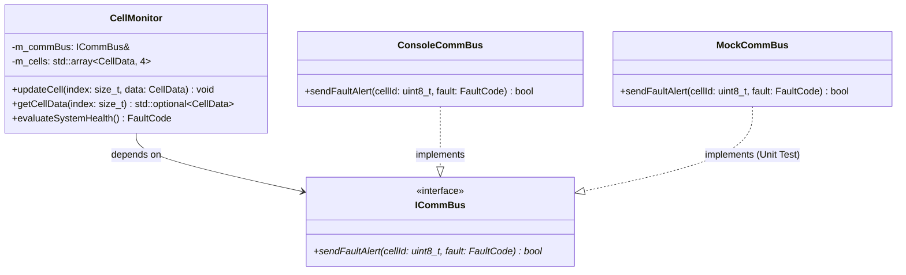

# Smart-BMS Cell Monitor & Embedded CI/CD Pipeline


A hardware-independent Battery Management System (BMS) cell monitoring library written in **Modern C++17**, accompanied by an automated **Docker & GitHub Actions CI/CD pipeline**, static code analysis (`cppcheck`), and unit tests using **GoogleTest / GoogleMock**.

---

## 🎯 Project Motivation

In modern embedded software engineering, decoupling core domain logic from low-level hardware drivers is essential for testability and maintainability. This project demonstrates:
* **Embedded-safe Modern C++17:** Zero dynamic memory allocation (`new`/`malloc`), deterministic memory footprint using `std::array`, and safe error handling via `std::optional` and strongly typed `enum class`.
* **Hardware Abstraction & Dependency Injection:** Decoupling the monitoring logic from the physical communication layer (`ICommBus`) to enable fast host-based unit testing with mocks.
* **Automated Quality Assurance:** Reproducible builds inside a Docker container, static code analysis, and automated test execution on every push.

---

## 🏗️ Software Architecture

The core library (`bms_core`) depends solely on the abstract `ICommBus` interface. At runtime, a concrete hardware driver (e.g., CAN/SPI) or a console simulator is injected. During testing, `MockCommBus` verifies exact fault-reporting behavior.



---

## 🛠️ Tech Stack & Tools

* **Language:** C++17 (`-Wall -Wextra -Wpedantic -Werror`)
* **Build System:** CMake (3.16+)
* **Testing Framework:** GoogleTest & GoogleMock (fetched automatically via CMake `FetchContent`)
* **Static Code Analysis:** Cppcheck
* **Containerization & CI/CD:** Docker (`ubuntu:24.04`), GitHub Actions

---

## 🚀 Quick Start (Local Build & Test)

### 1. Build natively with CMake
```bash
# Configure and build the project
cmake -B build -DCMAKE_BUILD_TYPE=Release
cmake --build build

# Run the simulation executable
./build/bms_sim

# Run the unit test suite
ctest --test-dir build --output-on-failure
```

### 2. Build and test inside Docker
To guarantee an identical build environment matching the CI pipeline:
```bash
# Build the Docker image
docker build -t bms-ci-env .

# Run static analysis, build, and tests inside the container
docker run --rm -v "\$(pwd):/workspace" bms-ci-env bash -c \
  "cppcheck --enable=warning,style,performance --error-exitcode=1 -I include src/ && \
   cmake -B build-docker && cmake --build build-docker && \
   ctest --test-dir build-docker --output-on-failure"
```

---

## 📈 Planned Extensions
* [ ] Add a moving average filter for noisy voltage/temperature sensor readings.
* [ ] Implement hysteresis thresholds for over-temperature recovery.
* [ ] Add code coverage reporting (`gcov` / `lcov`) to the GitHub Actions workflow.
